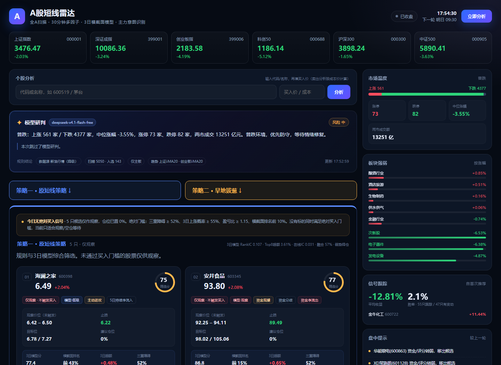

# A股短线雷达 · A-Share Short-Term Radar

盘中每 30 分钟扫描全市场 5000+ 只 A 股，用「规则筛选 → 日K精算 → 横截面机器学习排序 → 绝对买入门槛」四层漏斗，把 1–3 个交易日级别的候选收敛到个位数，再用本地看板把每个决策的依据、缺陷和未验证项摊开。

> 这个项目想证明的不是"我能选出涨停股"，而是**一个短线策略要对自己诚实有多难**。
> 每一轮报告都要回答三件事：为什么是它、为什么不是别人、什么情况下我会看错。评分不等于胜率，模型分和规则分分开标注，买不到的位置明确标"未触发"。



*2026-11-25 实拍：当天全市场普跌（中位数 −3.55%，下跌 4377 家），绝对买入门槛 **0 只通过**，5 只候选全部标注"仅观察 / 不触发买入"、仓位 0%。这个页面最有价值的状态不是"选出好票"，而是"明确告诉你今天别买"。*

## 它做了什么

| 层 | 内容 |
|---|---|
| **① 全市场快照** | 从东财接口拉约 5200 只 A 股的实时价格、涨跌幅、量比、换手、主力资金，失败时降级到新浪、腾讯 |
| **② 规则预筛** | 五因子加权（趋势 30 / 量价 25 / 资金 20 / 板块 10 / 形态 15），从 5000+ 收敛到 600，再做日K精算 |
| **③ 横截面模型** | XGBoost 排序 34 个特征（动量、量价、均线距离、行业动量、板块共振、市场状态），标签用未来 3 日超额收益分位 + 三重障碍（先止盈还是先止损），走步验证 |
| **④ 绝对买入门槛** | 3 日上涨概率、三重障碍通过率、盈亏比、横截面排名四项同时达标才给买入；否则只给观察 |
| **⑤ 风险层** | 公告事件过滤（控股股东减持/立案/退市风险 → 强制 0 仓）、板块共振门槛、趋势防守（现价须站上 MA20）、5% 止损距离复核 |

另有**独立第二策略「旱地拔葱」**：不依赖上面的候选池，直接从全市场按形态独立搜索"横盘很久、刚开始启动"的票（MACD 零轴金叉 + 均线粘合 + 缩量整理 + 站稳三线），分「形态预筛 / 接近形态观察」两层，与主策略并行展示。

## 验证记录（样本外分割）

见 `docs/model_metrics.json`。训练 2024-12-25 ~ 2026-08-17，验证 2026-08-21 ~ 2026-11-20（60 个交易日，52434 行）：

| 指标 | 数值 |
|---|---|
| Rank IC（3 日，横截面） | **0.107** |
| Rank ICIR | 0.59 |
| Top 10% 组合 3 日超额 | +1.07%（绝对收益 −0.13%） |
| Top 8 组合 3 日超额 / 命中率 | +3.61% / 52.3% |
| Top 3 组合 3 日收益 / 命中率 | +4.52% / 58.3% |
| 上涨方向准确率 | 57.9%（基准 49.3%） |
| 三重障碍方向准确率 | 59.9%（基准 47.8%） |
| 在线小样本（12 个预测日） | RankIC 0.031、命中 47.2% |

**这些数字的边界**：验证期与训练期不重叠，但同一份数据被用来选特征；未模拟停牌、涨跌停无法成交、滑点和 T+1 约束。它只能说明"排序里有一点信息"，不能说明"能赚钱"。

## 快速开始

```bash
pip install -r requirements.txt

python pipeline.py --force   # 生成首份报告，首次约 3–5 分钟（拉全市场快照 + 日K）
python server.py             # 打开 http://127.0.0.1:8765
```

Windows 下也可以直接双击 `立即分析.bat` / `启动看板.bat`；想让它每 30 分钟自动跑，用 `setup_task.ps1` 注册计划任务。

Python 3.10+。模型层需要 `xgboost`；缺依赖时自动降级为规则分，不会崩。

## 技术栈

Python 3.10+ · Flask · pandas / NumPy · scikit-learn · XGBoost（横截面回归 + 二分类，走步验证）· SQLite（WAL，增量缓存 + 复权变化检测）· 原生 JS 单页看板（零构建步骤）· Windows 计划任务 · 27 个离线单测（unittest）

数据全部来自公开接口（东方财富 / 新浪 / 腾讯），不需要付费行情源，也不需要任何 API Key。

## 目录

```
pipeline.py        主流程：快照 → 预筛 → 日K → 模型 → 门槛 → 报告落盘
engine.py          规则五因子、板块打标、绝对买入门槛判定
ranker.py          横截面 XGBoost：特征面板、三重障碍标签、走步验证、融合权重
cong.py            第二策略「旱地拔葱」：形态预筛、观察层、评分、板块共振门槛
events.py          公告事件过滤（东财公告标题规则分类 block / warn）
datasource.py      多数据源 + 降级（东财 / 新浪 / 腾讯）
kline_store.py     SQLite 日K缓存：增量、全量、复权变化检测、15 分钟复用
panel.py           横截面面板缓存（成分元数据 + 日K）
signal_guard.py    信号防重复、试探仓约束
ai.py              本地大模型研判（复用本机 CLI 登录态，不落任何密钥）
server.py          Flask 看板服务
web/index.html     单页看板（原生 JS，无构建步骤）
research/          研究脚本：形态层区分度的历史验证
test_*.py          27 个离线单测
```

## 设计原则

- **不算未来函数**：所有特征只用当日及之前的数据，行业映射、板块家数都按交易日对齐
- **不注水**：筛不出来就写"本轮无候选"，不降门槛凑数
- **可解释优先于准确**：宁可给出"为什么它不合格"的清单，也不给一个没有理由的高分
- **数据分层**：SQLite 日K 与缓存都在 `data/`，已加入 `.gitignore`，首次运行自动重建

## 免责声明

本项目仅用于技术研究与教学演示，**不构成任何投资建议**。A 股 T+1、涨跌停无法成交、滑点、停牌都会让纸面统计显著失真；所有历史验证结果都不代表未来收益。据此操作，风险自负。

## 更新日志

规则调整、被推翻的假设、每次验证的完整结论，见 [docs/CHANGELOG.md](docs/CHANGELOG.md)（约 30KB，按时间倒序）。
